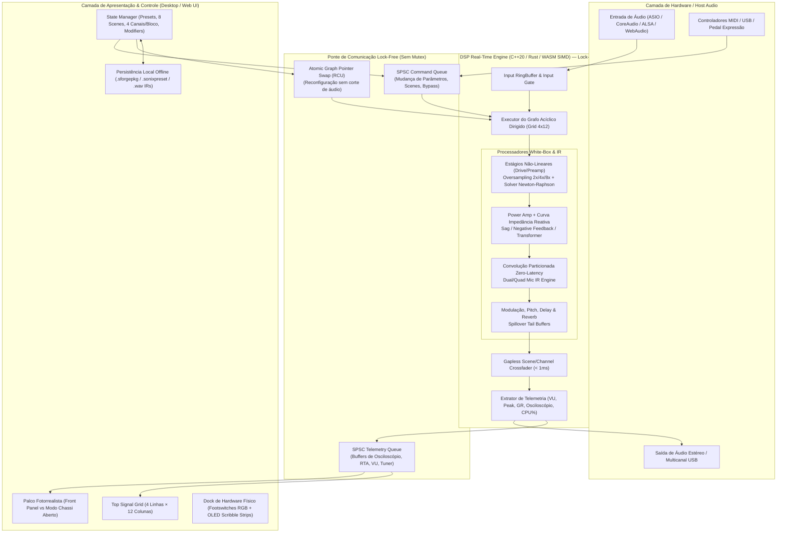
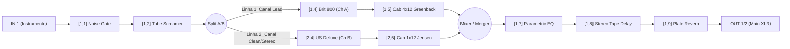
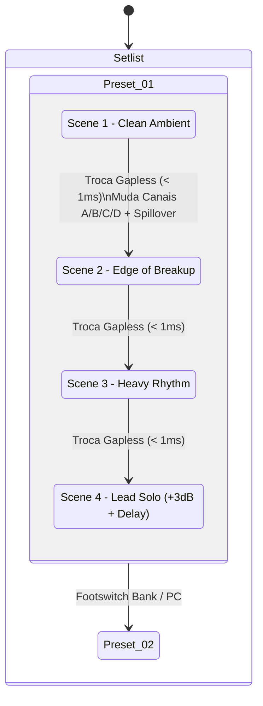

# Especificação de Requisitos de Software (SRS)
## Sistema Simulador de Pedaleira Multi-Efeitos e Amplificadores White-Box (**SONIX PRO // AMPFORGE™**)

- **Versão do Documento:** 1.0.0
- **Data:** 08/11/2026
- **Papel:** Análise de Sistemas & Arquitetura de Áudio em Tempo Real
- **Paradigma:** Ecossistema Híbrido (Motor DSP Nativo C++/Rust **AmpForge™** + Interface Desktop/Web **Sonix Pro** com Simulação de Hardware Físico)
- **Referências de Mercado:** Fractal Audio Axe-Fx III / FM9, Neural DSP Quad Cortex, Kemper Profiler, AmpliTube 5 / Neural DSP Archetype Series.

---

## 1. Visão Geral e Escopo do Produto

O sistema **SONIX PRO // AMPFORGE** é uma plataforma de processamento de áudio em tempo real de classe profissional projetada para simular toda a cadeia de sinal de guitarra e contrabaixo elétrico: desde a impedância de entrada do instrumento, passando por pedais analógicos/digitais, pré-amplificadores e amplificadores de potência valvulados modelados em nível de circuito pelo motor **AmpForge™ (100% White-Box Circuit Modeling)**, gabinetes acústicos com microfonação dinâmica e Impulse Responses (**IRs**), até efeitos de estúdio pós-amplificação e roteamento de palco.

### 1.1 Objetivos Estratégicos
1. **Fidelidade Sonora Absoluta (Motor AmpForge™ White-Box):** Simular fisicamente cada estágio de amplificação (triodos 12AX7, pentodos EL34/6L6, transformadores de saída, sag de fonte de alimentação, tone stacks passivos e curva de impedância reativa do alto-falante).
2. **Ecossistema Híbrido Portátil:** O núcleo de processamento de sinal (**AmpForge™ DSP Core Engine**) deve ser escrito em C++20 ou Rust sem dependências de SO no loop de áudio, permitindo compilação para:
   - **Desktop Standalone & Plugins (VST3 / CLAP / AU)**;
   - **Hardware Embarcado Dedicado** (Linux RT / ARM64 + DSP);
   - **Navegador Web** via **WebAssembly (WASM SIMD) + AudioWorklet**.
3. **Experiência Visual Skeuomórfica + Bancada "AmpForge™ Chassi Aberto":** Unir a satisfação tátil de equipamentos reais fotorrealistas (tolex, metal escovado, válvulas incandescentes, knobs 3D) com a bancada **"AmpForge™ Workbench / Chassi Aberto"**, onde o músico ou engenheiro ajusta componentes internos da bancada com auxílio de um osciloscópio/analisador de transferência em tempo real.
4. **Confiabilidade 100% Offline-First:** Operação totalmente autônoma e determinística no sistema de arquivos local, sem dependência de servidores de nuvem, contas de usuário ou conexão com a internet.

---

## 2. Arquitetura do Sistema

### 2.1 Diagrama de Arquitetura Híbrida e Isolamento de Threads

O sistema separa rigorosamente a **Thread de Áudio em Tempo Real (Hard Real-Time)** da **Thread de Interface e Gerenciamento de Estado (UI / Main Thread)** através de filas *Lock-Free Single-Producer Single-Consumer (SPSC)*.



### 2.2 Topologia do Grid de Sinal (Matriz 4×12)

O roteamento de áudio é modelado como um **Grafo Acíclico Dirigido (DAG)** disposto visualmente em uma matriz de **4 linhas por 12 colunas** (48 slots endereçáveis):



---

## 3. Requisitos Funcionais (RF)

### 3.1 Motor de Roteamento e Cadeia de Sinal (Signal Grid)

| ID | Requisito | Descrição e Regras de Negócio | Prioridade |
| :--- | :--- | :--- | :---: |
| **RF-001** | **Matriz de Roteamento 4×12** | O sistema deve disponibilizar um grid de 4 linhas paralelas por 12 colunas sequenciais. Cada célula pode hospedar um bloco de processamento ou um conector de cabo (shunt). | Alta |
| **RF-002** | **Nós de Split (Divisão de Sinal)** | Quando o sinal se divide para outra linha, um nó **Split** é criado automaticamente, oferecendo 3 modos: **Balance/A-B** (pan/nível entre linhas), **Crossover** (divisão por frequência em Hz para processamento multibanda, essencial para baixo e guitarras de 7/8 cordas) e **Dynamic Split** (roteamento baseado na força da palhetada). | Alta |
| **RF-003** | **Nós de Mixer / Merger** | Quando duas ou mais linhas convergem, um nó **Mixer** permite controlar Nível individual (-∞ a +12 dB), Panorâmica (L100 a R100), Inversão de Polaridade/Fase (0°/180°) por caminho e Nível Mestre. | Alta |
| **RF-004** | **Múltiplas Entradas e Saídas (I/O)** | Cada linha pode ter sua própria origem (`Instrument In 1`, `In 2 / Aux`, `FX Return L/R`, `USB Reamp In 3/4`) e seu próprio destino (`Main Out XLR L/R`, `Amp Out P10 sem Cab`, `FX Send`, `USB Record Out`). | Média |
| **RF-005** | **Prevenção de Loops de Realimentação** | O validador do grafo DAG deve impedir conexões que gerem ciclos infinitos não atrasados na matriz, sinalizando visualmente rotas inválidas. | Alta |

### 3.2 Modelagem White-Box de Amplificadores e Modo "Chassi Aberto (Mod Shop)"

| ID | Requisito | Descrição e Regras de Negócio | Prioridade |
| :--- | :--- | :--- | :---: |
| **RF-006** | **Painel Frontal Autêntico (Front Panel Mode)** | Exibição fotorrealista do cabeçote selecionado com seus controles originais de fábrica: `Input Gain`, `Overdrive/Lead Gain`, `Bass`, `Middle`, `Treble`, `Presence`, `Depth/Resonance`, `Master Volume`, `Output Level`, `Bright Switch` e `Channel Toggle`. | Alta |
| **RF-007** | **Modo Chassi Aberto (Mod Shop / Circuit View)** | Uma chave física na UI abre o chassi do amplificador, expondo os parâmetros internos da modelagem White-Box divididos em 4 subsistemas: **Preamp**, **Tone Stack**, **Power Amp** e **Power Supply**. | Alta |
| **RF-008** | **Customização do Estágio de Preamp** | No Modo Chassi Aberto, o usuário pode alterar o modelo das válvulas de pré (`12AX7A`, `ECC83S`, `12AT7`, `12AY7`, `EF86`), ajustar o `Preamp Tube Bias / Plate Voltage`, a dureza de saturação (`Triode Hardness`) e o filtro passa-altas entre estágios (`Interstage High-Pass Cut`). | Alta |
| **RF-009** | **Topologia e Posição do Tone Stack** | Permite alternar a topologia matemática do circuito de equalização passiva/ativa (`Passive James/Baxandall`, `Fender TMB Mid-Scoop`, `Marshall JCM Cathode Follower`, `Vox Top Boost`, `Mesa Mark Pre-Gain`) e sua localização no circuito (`Pre-Distortion`, `Post-Preamp`, `Post-Power Amp`). | Média |
| **RF-010** | **Simulação de Power Amp e Transformador** | Permite trocar o quarteto/dupla de válvulas de saída (`EL34`, `6L6GC`, `KT88`, `EL84`, `6V6`), classe de operação (`Class A` vs `Class AB Push-Pull`), corrente de repouso (`Power Tube Bias mA`), `Negative Feedback (NFB)`, `Phase Inverter Drive` e saturação do núcleo do transformador de saída (`Transformer Hysteresis & Core Size`). | Alta |
| **RF-011** | **Fonte de Alimentação e Sag Dinâmico** | Simulação da queda de tensão do barramento B+ sob transientes fortes (`Power Supply Sag`), permitindo escolher entre retificação valvulada (`GZ34 / 5U4GB`) ou retificação por diodo de silício (`Solid State Rectifier`), além da capacitância de filtragem (`B+ Time Constant` e `Ghost Note Filtering`). | Alta |
| **RF-012** | **Osciloscópio de Bancada e Curva de Transferência** | No Modo Chassi Aberto, um visor estilo CRT/OLED técnico exibe em tempo real: (a) Forma de onda de Entrada vs. Saída (Time Domain), (b) Curva de Transferência Não-Linear e Assimetria de Clipping (Waveshaper X-Y), e (c) Resposta em Frequência do Tone Stack + Curva de Impedância. | Alta |

### 3.3 Bloco de Gabinete (Cab / IR) e Acoplamento de Impedância

| ID | Requisito | Descrição e Regras de Negócio | Prioridade |
| :--- | :--- | :--- | :---: |
| **RF-013** | **Sala Visual de Microfonação (Virtual Mic Room)** | Interface fotorrealista mostrando o gabinete e o cone do falante, permitindo posicionar até 2 microfones simultâneos arrastando-os diretamente no eixo **Posição (Centro/Cap → Borda/Edge: 0 a 100%)**, **Distância (0 cm a 30 cm)** e **Ângulo (0° On-Axis vs 45° Off-Axis)**. | Alta |
| **RF-014** | **Catálogo de Microfones Modelados** | Cada slot de microfone permite escolher entre dinâmicos (`SM57`, `MD421`, `M88`), fita/ribbon (`R121`, `M160`) e condensadores (`U87`, `C414`), com controle individual de Nível, Pan, Mute/Solo, Fase (0°/180°) e Delay de alinhamento (0.00 a 2.00 ms). | Alta |
| **RF-015** | **Loader de Impulse Responses (IRs) Externos** | Suporte nativo para carregamento de arquivos `.wav` locais (mono/estéreo, 16/24/32-bit, 44.1 a 96 kHz, convertidos automaticamente para a taxa de amostragem da sessão), com navegador de pastas local, favoritos e busca rápida. | Alta |
| **RF-016** | **Acoplamento da Curva de Impedância (Speaker Impedance Curve)** | O bloco de Cab transmite automaticamente (ou permite seleção manual) a curva de impedância eletromecânica do falante (`Resonant Peak Frequency 65–130 Hz`, `Resonance Q`, `Voice Coil Inductance HF Rise`) para o bloco de Power Amp conectado antes dele. | Alta |
| **RF-017** | **Condicionamento de Gabinete e Sala (Room & Filters)** | Controles dedicados de `Low Cut` (20 Hz – 500 Hz, 6/12/18/24 dB/oct), `High Cut` (2 kHz – 20 kHz), `Speaker Thump / Cone Cry` (não-linearidade mecânica do cone) e `Room Mic / Early Reflections`. | Média |

### 3.4 Catálogo de Blocos de Efeitos e Utilitários

| ID | Requisito | Descrição e Regras de Negócio | Prioridade |
| :--- | :--- | :--- | :---: |
| **RF-018** | **Bloco Noise Gate / Input Gate** | Dois modos: `Intelligent Natural Gate` (rastreia o sinal DI limpo da entrada física para abrir/fechar mesmo após distorções pesadas) e `Classic Expander Gate`, com `Threshold`, `Ratio`, `Attack`, `Hold`, `Release` e medidor visual de atenuação (Gain Reduction). | Alta |
| **RF-019** | **Bloco Compressor (COMP)** | 4 topologias: `Pedal Comp (Ross/Dyna)`, `Studio FET (1176-style)`, `Optical (LA-2A-style)` e `VCA Master Bus`, com controle de `Parallel Mix (Dry/Wet)` e medidor VU de redução de ganho. | Alta |
| **RF-020** | **Bloco Overdrive / Distortion / Fuzz (DRIVE)** | Modelagem de circuito com seleção do tipo de diodo de clipping no Modo Mod Shop (`Silicon Symmetrical`, `Asymmetrical Si+LED`, `Germanium 1N34A`, `MOSFET`, `Hard Op-Amp`). Modelos base: `Green Screamer 808`, `Golden Klone Centaur`, `Black Rodent RAT`, `Orange Boss DS`, `Silicon/Germanium Fuzz Face` e `Big Muff Pi`. | Alta |
| **RF-021** | **Bloco Equalizador (EQ)** | 3 modos: `8-Band Parametric EQ` (com curva interativa sobre analisador de espectro RTA em tempo real), `5-Band Boogie Graphic EQ` (faders clássicos 80Hz, 240Hz, 750Hz, 2200Hz, 6600Hz) e `10-Band Pedal Graphic EQ`. | Alta |
| **RF-022** | **Bloco de Modulação (MOD)** | Modelos: `Analog BBD Chorus (CE-1/CE-2)`, `Tri-Chorus Estéreo`, `Through-Zero Flanger`, `Orange 90 Phaser (4/8/12 stages)`, `Optical/Bias Tremolo`, `Photocell Univibe` e `Rotary Speaker (Horn/Drum Speed)`. Todos com suporte a sincronia por BPM (`Note Division`). | Alta |
| **RF-023** | **Bloco de Pitch & Harmonizer (PITCH)** | Modelos: `Pedal Whammy` (controlado por pedal de expressão), `Polyphonic Drop / Virtual Capo` (mudança de afinação em semitons de -12 a +12), `Intelligent Dual Harmonizer` (escolha de Tonalidade Maior/Menor/Modos Gregos e intervalos de 3ª, 5ª, 6ª, 8ª) e `Micro Pitch Detune`. | Média |
| **RF-024** | **Bloco de Delay (DELAY)** | Modelos: `Multi-Head Magnetic Tape Echo` (com `Wow`, `Flutter`, `Tape Age` e auto-oscilação), `Analog Bucket-Brigade (BBD)`, `Pristine Studio Digital Delay`, `Dual Parallel Delay`, `Reverse Delay` e `Ping-Pong Stereo`. Inclui `Ducking` (abaixa o delay enquanto o músico toca) e `Spillover` na troca de cena. | Alta |
| **RF-025** | **Bloco de Reverb (REVERB)** | Modelos: `Tube Driven Spring Reverb` (com parâmetro de tensão das molas e "drip"), `Studio Vintage Plate`, `Concert Hall`, `Chamber` e `Shimmer / Cloud Ambient` (com oitavas cristalinas na cauda). | Alta |
| **RF-026** | **Afinador Estroboscópico e Polifônico (TUNER)** | Acionável via cabeçalho ou segurando o Footswitch dedicado. Oferece visão **Strobe de alta precisão (±0.1 cent)** e visão **Polifônica** (mostra as 6 cordas simultaneamente), referência A4 ajustável (430–450 Hz), temperamentos compensados (Sweetened Guitar) e modo `Mute` ou `Bypass`. | Alta |
| **RF-027** | **Looper de Performance Integrado** | Looper estéreo posicionável no início (para testar timbres de amps com as mãos livres!) ou no final da cadeia (para performance ao vivo). Funções: `Record`, `Play`, `Overdub`, `Undo/Redo`, `Reverse`, `Half-Speed` e indicador circular de compasso. | Média |

### 3.5 Hierarquia de Presets, 8 Scenes, 4 Canais por Bloco e Modifiers



| ID | Requisito | Descrição e Regras de Negócio | Prioridade |
| :--- | :--- | :--- | :---: |
| **RF-028** | **Hierarquia Setlist → Preset → 8 Scenes** | O sistema organiza bancos em **Setlists** (repertórios de shows). Cada Preset contém toda a topologia do Grid 4×12 e **8 Scenes (Cenas A até H)**. | Alta |
| **RF-029** | **4 Canais Independentes (A/B/C/D) por Bloco** | Cada bloco no Grid possui **4 Canais (A, B, C, D)** independentes na memória. Por exemplo, o bloco `AMP 1` pode ter um Fender Twin no Canal A, um Vox AC30 no Canal B, um Marshall Plexi no Canal C e um Dual Rectifier no Canal D, sem consumir CPU dos canais inativos. | Alta |
| **RF-030** | **Troca de Cena sem Corte de Áudio (Gapless Switching)** | Ao trocar de Scene (A–H), o sistema aplica instantaneamente o estado de Bypass (On/Off) e o Canal ativo (A/B/C/D) de todos os blocos com crossfade em janela cosseno de 1.5 ms, mantendo as caudas de Delay e Reverb soando naturalmente (**Spillover**). | Alta |
| **RF-031** | **Sistema Universal de Modifiers (Automação)** | Clicar com o botão direito em qualquer knob abre o painel **Modifier Matrix**, permitindo modular aquele parâmetro em tempo real usando: `Expression Pedal 1/2`, `MIDI CC (0-127)`, `Internal LFO 1/2`, `Envelope Follower (Input Dynamics)` ou `Scene Controller`, com curva parametrizável (`Min`, `Max`, `Slope/Midpoint`, `Damping ms`). | Alta |
| **RF-032** | **Modos de Footswitch Físico (Preset / Scene / Stomp / Hybrid)** | Os 8 footswitches principais da pedaleira podem operar em 4 modos selecionáveis: **Preset Mode** (troca presets), **Scene Mode** (seleciona Scenes A–H), **Stomp Mode** (liga/desliga pedais individuais como pedaleira analógica) ou **Hybrid Mode** (fileira superior = 4 Stomps, fileira inferior = 4 Scenes principais). | Alta |
| **RF-033** | **Persistência 100% Local Offline e Pacotes (.sforgepkg)** | Todos os Presets, Setlists e IRs são armazenados localmente. O usuário pode exportar ou importar um Preset único (`.sonixpreset` em JSON legível) ou um pacote autocontido (`.sforgepkg` — arquivo compactado contendo o JSON do Preset/Setlist + todos os arquivos `.wav` de IRs utilizados embutidos com verificação SHA-256). | Alta |

---

## 4. Requisitos Não-Funcionais (RNF — Padrão Pro-Audio Rigoroso)

| ID | Categoria | Especificação Técnica e Métrica de Aceitação |
| :--- | :--- | :--- |
| **RNF-001** | **Latência Interna de DSP** | A latência algorítmica interna adicionada pelo motor DSP (incluindo filtros de oversampling de fase mínima e convolução de IR particionada) deve ser **< 1.5 ms** a 48 kHz / 96 kHz. |
| **RNF-002** | **Tamanhos de Buffer e Taxa de Amostragem** | Suporte nativo a taxas de amostragem de `44.1 kHz`, `48 kHz`, `88.2 kHz` e `96 kHz`, operando de forma estável com buffers de hardware desde `32 samples` (0.66 ms @ 48kHz) até `512 samples`. |
| **RNF-003** | **Precisão Numérica Interna** | O barramento de áudio do Grid opera em `32-bit IEEE 754 floating-point` com alinhamento SIMD (AVX2 / NEON / WASM SIMD128). Os solucionadores não-lineares de circuito (Newton-Raphson / DK-Method de válvulas e diodos) e acumuladores de filtros IIR abaixo de 100 Hz devem operar internamente em **`64-bit double precision`** para evitar ruído de quantização e instabilidade numérica. |
| **RNF-004** | **Oversampling Anti-Aliasing Dinâmico** | Todo bloco não-linear (`DRIVE`, `AMP Preamp/PowerAmp`, `Fuzz`) deve suportar Oversampling configurável (`1x Eco`, `2x Standard`, `4x High`, `8x Ultra Studio`) usando filtros polifásicos Half-Band com rejeição de banda de passagem > 96 dB para eliminar *aliasing* harmônico. |
| **RNF-005** | **Garantia Real-Time Safe (Zero Lock / Zero Alloc)** | Na thread de áudio (`processBlock`), é **estritamente proibido**: (1) alocar ou liberar memória dinâmica (`malloc`, `free`, `new`, `delete`, `std::vector::push_back`), (2) usar `mutex`, `semaphore` ou `condition_variable`, (3) realizar chamadas de sistema (I/O de disco ou rede), ou (4) lançar exceções. |
| **RNF-006** | **Suavização de Parâmetros (Zipper-Noise Free)** | Qualquer alteração em controles contínuos (Ganhos, Frequências de EQ, Mix, Pedal de Expressão) deve passar por um filtro suavizador de 1 polo (`One-Pole Parameter Smoother` com constante de tempo de 5ms a 20ms) em nível de sample para eliminar cliques e *zipper noise*. |
| **RNF-007** | **Orçamento e Telemetria de CPU/DSP** | O sistema deve medir o tempo de execução real de cada bloco usando contadores de alta resolução comparados à janela de tempo do buffer ($\text{Deadline} = \frac{\text{BufferSize}}{\text{SampleRate}}$), exibindo na UI o consumo global (%) e o custo individual de cada bloco. Se o consumo atingir 88%, o sistema ativa um alerta preventivo e impede a adição de blocos pesados para evitar *audio dropouts (xruns)*. |
| **RNF-008** | **Taxa de Quadros da Interface (UI Rendering)** | A interface gráfica (incluindo os medidores VU, luzes de válvulas respondendo ao envelope dinâmico, anéis de LED e osciloscópio CRT) deve renderizar a **60 FPS constantes** (ou 120 Hz em monitores ProMotion) sem interferir na prioridade de escalonamento da thread de áudio. |
| **RNF-009** | **Operação 100% Offline e Portabilidade** | O aplicativo não deve realizar nenhuma requisição HTTP externa obrigatória. Toda biblioteca de presets de fábrica, modelos matemáticos de válvulas e IRs devem residir localmente com caminhos relativos dentro de pacotes `.sforgepkg`. |

---

## 5. Especificação do Esquema de Dados Local (JSON Preset Schema)

Abaixo está a definição formal do formato de arquivo `.sonixpreset` utilizado para persistência local e troca offline de timbres:

```json
{
  "$schema": "https://sonixpro.local/schemas/sonixpreset-v1.json",
  "schemaVersion": "1.0.0",
  "metadata": {
    "id": "b7e239a0-91f4-4c6e-a182-7f902d11e8c1",
    "name": "Brit 800 Modded Studio Rig",
    "author": "Estúdio Local",
    "category": "High Gain / Rock",
    "tempoBpm": 124.0,
    "createdAt": "2026-11-08T14:30:00-03:00",
    "footswitchMode": "HYBRID_STOMP_SCENE"
  },
  "activeSceneIndex": 2,
  "scenes": [
    { "index": 0, "id": "A", "name": "CLEAN SPARKLE", "color": "#00E5FF" },
    { "index": 1, "id": "B", "name": "CRUNCH PLEXI",  "color": "#FFB300" },
    { "index": 2, "id": "C", "name": "MODDED 800",    "color": "#FF3D00" },
    { "index": 3, "id": "D", "name": "SOLO LEAD +3dB","color": "#D500F9" }
  ],
  "grid": {
    "rows": 4,
    "cols": 12,
    "blocks": [
      {
        "instanceId": "blk_amp_1",
        "type": "AMP",
        "row": 0,
        "col": 4,
        "oversampling": "4x",
        "activeChannelByScene": [0, 1, 2, 2, 0, 1, 2, 3],
        "bypassByScene": [false, false, false, false, false, false, false, false],
        "channels": {
          "C": {
            "modelId": "brit_jcm800_2203",
            "frontPanel": {
              "inputGain": 7.4,
              "bass": 6.2,
              "middle": 7.8,
              "treble": 6.5,
              "presence": 5.9,
              "depth": 6.4,
              "masterVolume": 4.2,
              "brightSwitch": true
            },
            "circuitModShop": {
              "preampTubeType": "ECC83S_JJ",
              "preampPlateVoltage": 295.0,
              "preampBiasShift": 0.12,
              "toneStackTopology": "MARSHALL_CATHODE_FOLLOWER",
              "toneStackLocation": "POST_PREAMP",
              "powerTubeType": "EL34_MULLARD",
              "powerTubeBiasMa": 38.5,
              "powerSupplyRectifier": "SOLID_STATE_DIODE",
              "powerSupplySag": 3.4,
              "negativeFeedback": 4.8,
              "transformerSaturation": 5.2
            }
          }
        }
      },
      {
        "instanceId": "blk_cab_1",
        "type": "CAB",
        "row": 0,
        "col": 5,
        "coupledAmpInstanceId": "blk_amp_1",
        "impedanceCurve": {
          "model": "4x12_UK_GREENBACK_25W",
          "lowResonanceHz": 98.0,
          "lowResonanceGainDb": 6.8,
          "highInductanceRiseDb": 4.5
        },
        "mics": [
          {
            "slot": 1,
            "enabled": true,
            "micModel": "DYN_57",
            "positionCapToEdge": 0.32,
            "distanceCm": 2.5,
            "angleOffAxisDeg": 0,
            "levelDb": 0.0,
            "pan": -0.15,
            "phaseInvert": false,
            "delayMs": 0.0
          },
          {
            "slot": 2,
            "enabled": true,
            "micModel": "RIBBON_121",
            "positionCapToEdge": 0.58,
            "distanceCm": 6.0,
            "angleOffAxisDeg": 15,
            "levelDb": -3.5,
            "pan": 0.15,
            "phaseInvert": false,
            "delayMs": 0.08
          }
        ]
      }
    ]
  },
  "modifiers": [
    {
      "id": "mod_1",
      "source": "EXP_PEDAL_1",
      "targetBlockId": "blk_amp_1",
      "targetParam": "frontPanel.inputGain",
      "minVal": 3.5,
      "maxVal": 8.5,
      "curveSlope": 0.5,
      "dampingMs": 12.0
    }
  ]
}
```
