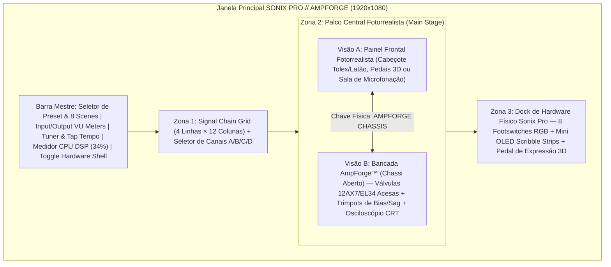

# Especificação do Design System
## **SONIX PRO // AMPFORGE™ — Tactile Skeuomorphic & Pro-Audio Hardware Design System**

- **Versão:** 1.0.0
- **Paradigma Visual:** Skeuomorfismo Fotorrealista de Alta Precisão + Bancada Técnica "AmpForge™ Chassi Aberto (Mod Shop)" + Simulação Física de Pedaleira de Chão **Sonix Pro**
- **Inspirações:** Neural DSP Archetype Series, Fractal Audio Axe-Fx III, Quad Cortex Hardware Chassis, Osciloscópios Tektronix e Amplificadores Valvulados Clássicos (Marshall, Fender, Vox, Mesa/Boogie).

---

## 1. Princípios de Design e Direção de Arte

1. **Fisicalidade Autêntica (Material Honesty):** Cada superfície comunica seu material real por meio de microtexturas procedurais CSS/SVG, reflexos especulares anisotrópicos e sombras multicamadas:
   - **Tolex Vinílico Texturizado** nas caixas de amplificadores e gabinetes;
   - **Latão Escovado (Brushed Brass), Cromo Espelhado e Alumínio Anodizado Preto** nos painéis frontais e no chassi da pedaleira;
   - **Vidro e Filamento Incandescente** nas válvulas termiônicas (`12AX7` / `EL34`), cuja luminosidade reage dinamicamente à corrente de Bias (mA) e à amplitude do sinal de áudio;
   - **Fósforo CRT Verde/Ciano e Displays OLED Matriciais** nos medidores de bancada e *Scribble Strips* dos footswitches.
2. **Hierarquia em Três Zonas (Zero Poluição Visual):**
   - **Zona 1 — Top Bar & Signal Grid (4×12):** Visão macro da cadeia de sinal com miniaturas táticas, fluxo de cabos luminosos e seleção de Canais (`A/B/C/D`).
   - **Zona 2 — Palco Central Fotorrealista (Main Stage):** O equipamento selecionado em tamanho real. Possui a chave mecânica **"OPEN CHASSIS / MOD SHOP"** que abre a tampa metálica do amplificador revelando as válvulas, trimpots de circuito e o osciloscópio de bancada.
   - **Zona 3 — Dock Inferior de Hardware (Footswitch Deck & Hardware Shell):** Representa a fileira física de *footswitches* de aço usinado com anéis de LED RGB, mini-telas OLED (*Scribble Strips*) e Pedal de Expressão, podendo expandir para o **Modo Palco (Hardware Shell Completo)**.
3. **Ergonomia de Estúdio e Palco:**
   - Todos os controles rotativos operam por **arraste vertical (Vertical Drag)** com precisão contínua, **Shift + Drag** para ajuste fino (0.01), **Duplo Clique** para restaurar valor de fábrica e **Clique Direito** para abrir a matriz de **Modifiers (EXP / MIDI / LFO / Envelope)**.

---

## 2. Design Tokens (Cores, Materiais, Iluminação e Sombras)

### 2.1 Paleta de Superfícies e Materiais Físicos

| Token CSS | Valor / Gradiente | Aplicação Física |
| :--- | :--- | :--- |
| `--surface-chassis-anodized` | `linear-gradient(180deg, #1b1d22 0%, #111317 50%, #0b0c0f 100%)` | Carcaça de alumínio anodizado preto da pedaleira |
| `--surface-tolex-black` | `radial-gradient(circle at 2px 2px, #1e2024 1px, #0d0e11 2px)` (4px×4px) | Revestimento de vinil Tolex dos cabeçotes e gabinetes |
| `--surface-faceplate-gold` | `linear-gradient(180deg, #e7c873 0%, #c89f3c 48%, #a67c1e 52%, #d8b457 100%)` | Painel frontal clássico estilo Brit/Marshall Plexi & 800 |
| `--surface-faceplate-chrome` | `linear-gradient(180deg, #e8edf2 0%, #9aa4b0 49%, #68717d 51%, #cfd6de 100%)` | Painel cromado estilo US Blackface / Dual Rectifier |
| `--surface-circuit-board` | `linear-gradient(180deg, #0d1614 0%, #070c0b 100%)` | Bancada interna do Modo Chassi Aberto (Mod Shop) |
| `--surface-oled-screen` | `#05080c` com borda chanfrada `#1d2430` | Visores OLED dos Scribble Strips e Afinador |
| `--surface-crt-phosphor` | `radial-gradient(circle, #07221b 0%, #03100d 100%)` | Tela do Osciloscópio de Bancada (Modo Chassi Aberto) |

### 2.2 Tokens Semânticos de Categorias de Blocos e Anéis LED RGB

Cada categoria de bloco na cadeia de sinal possui uma cor de LED própria que ilumina tanto o slot no Grid 4×12 quanto o anel RGB do Footswitch associado:

| Categoria de Bloco | Token CSS | Hex | Significado / Equipamento |
| :--- | :--- | :---: | :--- |
| **IN / GATE** | `--led-gate` | `#00E676` | Noise Gate / Input Sens / Impedância |
| **COMP** | `--led-comp` | `#00B0FF` | Compressores de Pedal e Estúdio (FET/Opto) |
| **DRIVE** | `--led-drive` | `#FF9100` | Overdrives, Distortions e Fuzzes |
| **AMP (White-Box)** | `--led-amp` | `#FF3D00` | Cabeçotes Valvulados (Preamp + Power Amp) |
| **CAB (Mic/IR)** | `--led-cab` | `#FFC400` | Gabinetes, Microfonação 3D e Loader de IR |
| **EQ** | `--led-eq` | `#1DE9B6` | Equalizadores Paramétricos e Gráficos |
| **MOD** | `--led-mod` | `#7C4DFF` | Chorus, Flanger, Phaser, Tremolo, Rotary |
| **PITCH** | `--led-pitch` | `#E040FB` | Whammy, Harmonizer, Virtual Capo |
| **DELAY** | `--led-delay` | `#00E5FF` | Tape Echo, Analog BBD, Digital Dual Delay |
| **REVERB** | `--led-reverb` | `#651FFF` | Spring Tank, Plate, Hall, Shimmer |

### 2.3 Tokens de Incandescência Valvulada e Sombras Realistas

```css
:root {
  /* Incandescência das Válvulas (varia com Bias e Envelope de Áudio) */
  --tube-glow-idle: 0 0 18px rgba(255, 115, 0, 0.55), inset 0 0 12px rgba(255, 160, 40, 0.75);
  --tube-glow-hot:  0 0 34px rgba(255, 80, 0, 0.92), 0 0 65px rgba(255, 145, 0, 0.45), inset 0 0 18px #fff3b0;

  /* Elevação Física de Componentes 3D */
  --shadow-knob-3d: 0 10px 18px rgba(0, 0, 0, 0.75), 0 3px 6px rgba(0, 0, 0, 0.6), inset 0 1px 1px rgba(255, 255, 255, 0.35);
  --shadow-chassis-inset: inset 0 4px 14px rgba(0, 0, 0, 0.85), inset 0 1px 2px rgba(0, 0, 0, 0.9);
  --shadow-footswitch: 0 8px 16px rgba(0, 0, 0, 0.85), inset 0 2px 3px rgba(255, 255, 255, 0.45);
}
```

---

## 3. Tipografia e Serigrafia de Hardware

| Função | Família Tipográfica | Estilo / Características |
| :--- | :--- | :--- |
| **Serigrafia de Amplificadores (Faceplate Labels)** | `'Oswald'`, `'Bebas Neue'`, `'Impact'`, sans-serif condensada | Caixa alta, tracking `0.12em`, peso `700`, simulando tinta serigrafada preta ou branca sobre metal escovado |
| **Displays OLED, Scribble Strips & Telemetria DSP** | `'JetBrains Mono'`, `'Share Tech Mono'`, monospace | Números tabulares (`font-variant-numeric: tabular-nums`), efeito sutil de *text-shadow* luminoso |
| **Interface de Sistema, Grid & Modais Técnicos** | `'Inter'`, system-ui, sans-serif | Alta legibilidade em tamanhos pequenos (11px–14px), contraste WCAG AAA sobre fundo escuro |

---

## 4. Catálogo de Componentes do Design System (Anatomia & Estados)

### 4.1 Knob Rotativo Skeuomórfico 3D (`<sonix-knob>`)
- **Variantes de Estilo:**
  1. **Marshall Skirted Knob:** Corpo preto estriado com saia numerada (0–10) e topo de latão dourado/prateado com marcador físico.
  2. **Chicken Head Knob:** Ponteiro clássico em baquelite creme/preto para amplificadores vintage e chaves seletoras rotativas.
  3. **Precision Studio Encoder (AmpForge™ Mod Shop):** Alumínio anodizado recartilhado com anel de LED pontilhado ao redor para ajustes de circuito (Bias mA, Plate Voltage, Sag).
- **Anatomia Visual:**
  - Arco perimetral de medição com marcações graduadas;
  - Sombra projetada fixa no painel (não gira junto com o knob!) + corpo rotativo com iluminação cônica (`conic-gradient`) simulando reflexo de luz zenital;
  - Indicador de **Modifier Ativo**: Quando vinculado a um Pedal de Expressão ou LFO, exibe um segundo arco colorido (ciano/âmbar) mostrando a faixa `Min ↔ Max` e a posição modulada em tempo real.
- **Estados:** `Default`, `Hover` (exibe tooltip numérico exato em dB/Hz/%), `Dragging` (foco de precisão), `Fine-Tune (Shift)` e `Modulated (Automated)`.

### 4.2 Válvula Termiônica Interativa (`<ampforge-vacuum-tube>`) — Bancada AmpForge™
- **Anatomia Visual:** Bulbo de vidro cilíndrico translúcido com reflexo especular lateral, placas metálicas internas cinza-grafite (`Anode Plates`), grade espiral, getter espelhado no topo e filamento incandescente laranja/âmbar na base e centro.
- **Interatividade Direta:**
  - Clicar na válvula abre o seletor rápido de modelo (`12AX7A`, `ECC83S`, `12AT7` para pré; `EL34`, `6L6GC`, `KT88`, `6V6` para potência);
  - A intensidade do brilho alaranjado responde em tempo real ao potenciômetro de **Power Tube Bias (mA)** e pulsa sutilmente com o ataque da guitarra (compressão de Sag/Corrente de Placa).

### 4.3 Osciloscópio CRT & Analisador de Curva White-Box (`<ampforge-crt-scope>`)
- **Modos de Visualização:**
  1. **WAVEFORM (Tempo):** Exibe o sinal DI de entrada (verde tracejado) sobreposto à onda saturada pós-válvulas (ciano brilhante), evidenciando o *soft-clipping* assimétrico dos triodos e o *sag* de ataque.
  2. **TRANSFER CURVE (X-Y Waveshaper):** Plota a curva matemática de entrada vs. saída em tempo real, mostrando o ponto de operação do Bias e o limiar de corte (clipping).
  3. **TONE STACK & IMPEDANCE (Frequência):** Plota a curva combinada do Tone Stack (Bass/Mid/Treble) + a Curva de Impedância Ressonante acoplada do alto-falante.

### 4.4 Sala de Microfonação 3D/2D do Gabinete (`<sonix-cab-mics>`)
- **Anatomia Visual:**
  - Vista frontal/perspectiva do alto-falante com tecido *grill cloth* semi-transparente revelando a calota central (*Dust Cap*) e o cone de papel (*Speaker Cone*);
  - Até 2 cápsulas de microfone físicas (`SM57`, `R121`, `U87`, `MD421`) que o usuário **arrasta com o mouse**;
  - Eixo X controla a posição `Cap Edge (0% a 100%)` (mais brilho no centro, mais grave/escuro na borda) e Eixo Y/Scroll controla a `Distância (0 cm a 30 cm)`.

### 4.5 Footswitch Metálico com Anel RGB e OLED Scribble Strip (`<sonix-footswitch>`)
- **Anatomia Visual:**
  - Mini-display OLED superior (`128×32px` simulado) com borda chanfrada exibindo o código do switch (`FS 1` a `FS 8`), o modo (`SCENE C` ou `STOMP`) e o nome do bloco/cena;
  - Êmbolo de aço inoxidável usinado com porca sextavada realista;
  - Anel difusor de acrílico iluminado por LED RGB com estados: **Aceso Brilhante (100% + Glow)** quando ativo, **Dimmed (25% opacidade)** quando em Bypass na cena atual, e **Piscando no BPM** para o switch de `TAP TEMPO`.

---

## 5. Mapa de Layout Responsivo (Estúdio vs. Modo Hardware Shell)


